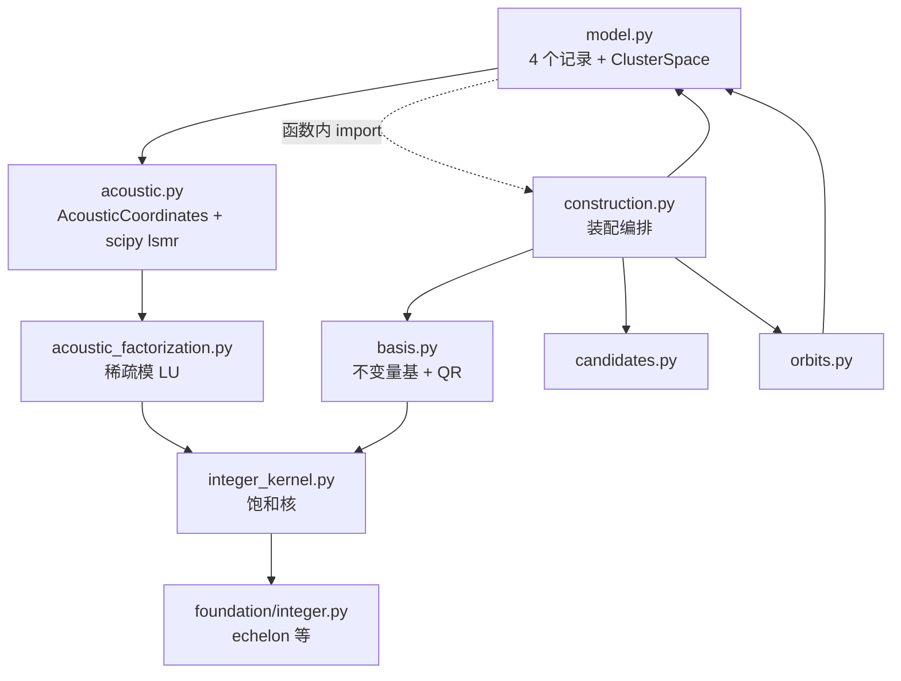

# cluster_space 工程结构审查：模块划分、类设计与 Rust 整体替换的边界

本页是静态审查，未运行代码。审查目标是回答两个问题：现有 `cluster_space` 的分层与类设计是否合理；如果将来用 Rust **整体替换**某些模块、把 Python 留作上层包装，现有边界是否支持这种做法。`Rust` 化的算术与证书分析见[重计算核心调查](rust-heavy-computation-study.md)。

## 结论

1. **按数学主题横切，而不是按"数据 / 编排 / 数值核"分层。** 9 个文件里只有 `candidates.py` 同时满足"纯数组进出、无状态、无记录类型、无 SciPy/LAPACK"这一可整体替换的标准。`integer_kernel.py` 与 `acoustic_factorization.py` 共享内核级 import，任何"整模块替换"都必须把两者连同 `foundation/integer.py` 的 `echelon`/`prime_stream` 一起换。
2. **记录类型是事实上的公共契约，不能下沉。** `Orbit`、`OrderBlock`、`ClusterSpace` 的字段被 `mapping`、`fitting`、`force_constants` 跨包直接读取（至少 20 处），所以它们恰好是合适的 Python 包装层；但 `Orbit` 目前把对称数据、计算产物和诊断浮点混在一个值对象里。
3. **最大的分层问题是驱动逻辑放在数据模块。** `model.py` 顶部 import `acoustic`（进而 numba + scipy.sparse.linalg），`ClusterSpace.__init__` 通过函数内 import 调用 `construction.construct_space` 并顺带触发 ASR 准备。于是"数据记录"既是最底层，又是装配入口，还拉起了最重的依赖栈；`model ↔ construction` 的循环依赖被惰性 import 掩盖。
4. **同一份字段清单被维护三次**（`ClusterSpace.__init__`、`with_masses`、`force_constants/native.py:load`），并且跨包代码用 `object.__setattr__(space, "_acoustic_coordinates", None)` 写入私有字段。这是当前可维护性风险最高的一处。
5. **可读性整体高于同类科研代码**：模块 docstring 与函数 docstring 有物理语义、错误分类清楚、分配与算术准入统一、每个数值模块都有独立测试。弱点集中在少量"双模式内核"、位置元组返回值、以及两套并存的记录表示（`Cluster.sites` 与 `Cluster.labels`）。

## 1. 现状的依赖图



被虚线掩盖的 `model ↔ construction` 是唯一的环；`model → acoustic → acoustic_factorization → integer_kernel` 使得 import 一个数据类就会加载 numba 与 SciPy。

## 2. 逐模块边界质量

| 模块 | 行数 | 公开面 | 输入类型 | 输出类型 | 重依赖 | 可整模块替换 |
|---|---|---|---|---|---|---|
| `candidates.py` | 227 | `enumerate_candidate_labels` | 数组 + 标量 | `int64` 数组 | numba | **可以**（最干净） |
| `integer_kernel.py` | 579 | `integer_kernel_basis`，共 12 个 numba 内核，其中 2 个被 `acoustic_factorization` 引用 | `int64` 数组 | `int64` 数组 | numba | 需与 `acoustic_factorization`、`foundation.integer` 一起换 |
| `acoustic_factorization.py` | 375 | `factor_acoustic_equations` | `scipy.sparse.csr_matrix` | 三个数组 | scipy.sparse + numba typed `Dict` | 同上 |
| `orbits.py` | 310 | `compute_orbit_actions`、`ClusterRegistry` | `Cluster` 数据类 | 5 元组（含 `Cluster` 元组） | numba | **不可以**（记录类型 + 有状态类） |
| `basis.py` | 268 | 5 个函数（`__all__` 却为 `[]`） | 标签元组、`(rotation, permutation)` 元组 | 数组 + `float` | **SciPy QR/LAPACK** | **不可以**（精确内核与浮点混装） |
| `construction.py` | 193 | `construct_space` | 几何数组 + `Mapping` | 记录元组 | 无 | 本就是编排层，应留 Python |
| `model.py` | 479 | 4 个记录 + `ClusterSpace` | `ase.Atoms` | 记录 | ASE，且经 `acoustic` 拉入 SciPy | 应留 Python（包装层） |
| `acoustic.py` | 309 | `AcousticCoordinates` + 3 个函数 | `csr_matrix`、数组 | 记录 / 数组 | scipy `lsmr` + 回调 | **不可以**（算子 + 回调） |

判据用六条：只收发标量与数组；无跨调用状态；算术域契约自足；错误可一一映射为枚举；不依赖 ASE/LAPACK/SciPy 稀疏与迭代器；不与其他待替换模块互相 import。按这六条，上表 8 个模块中只有 `candidates.py` 合格，而一个"可整体替换的整数内核单元"横跨 3 个文件。

## 3. 按严重度排序的具体问题

### P1：`model.py` 同时是数据层、装配层和依赖汇聚点

- `model.py:12` 顶层 `from ...acoustic import prepare_acoustic_coordinates`。后果：任何只想要 `Cluster`/`Orbit` 的调用方都会加载 numba、scipy.sparse.linalg 和全部精确内核；数据层不再是叶子。
- `model.py:286` 函数内 `from ...construction import construct_space` 掩盖了 `model ↔ construction` 的环。
- `model.py:320` 在 `__init__` 末尾直接调用 ASR 准备，把"构造空间"与"准备声学坐标"两件事绑在同一个构造器里，`asr=True` 的失败会表现为构造失败。

判断：`ClusterSpace` 保留为只读记录与校验；装配（`construct_space` + ASR 准备）移到 `assembly.py`，`ClusterSpace` 只暴露一个 `classmethod build(...)` 的薄委托。这是让"Python 上层包装 + Rust 内核"成立的前置条件。

### P1：字段清单三处复制 + 私有字段跨包写入

- `model.py:282-321`：`__init__` 逐字段 `object.__setattr__`。
- `model.py:339-364`：`with_masses` 用 `object.__new__` + 手写字段名元组复制。
- `force_constants/native.py:184-193`：`load` 再写一遍同样的字段名元组，并显式 `object.__setattr__(space, "_acoustic_coordinates", None)`。

后果：新增一个记录字段需要改三处，漏改不会在构造时报错，只会在使用处 `AttributeError` 或在 HDF5 往返中静默丢字段；`native.load` 绕过公开构造路径，等于把"ASR 未准备"这一状态做成私有后门。

建议：把"从已算好的各部件组装记录"收敛为一个显式的 `ClusterSpace._from_parts(...)`（或 `dataclasses.replace` 风格的构造入口），`__init__`、`with_masses`、`load` 都走它；`_acoustic_coordinates` 用 `None` 作为公开语义（已有 `asr` 属性可读）而不是跨包写私有名。

### P1：数值内核跨模块 import，破坏"整模块替换"

- `acoustic_factorization.py:20` 从 `integer_kernel` import `reconstruct_rationals`、`scale_to_common_denominator`。
- `integer_kernel.py:21` 从 `foundation.integer` import `echelon`、`prime_stream`、`as_int64_matrix`、`RANK_PRIMES`。
- `basis.py:18` 依赖 `integer_kernel_basis`。

后果：三个文件在数学上是同一层（精确整数代数），但按主题被拆开，且以"内核函数"粒度互相引用。想换掉 `integer_kernel` 就必须同时改 `acoustic_factorization` 的 import 与 `basis` 的调用，谈不上"整体替换一个模块"。

建议：先建立 `_core/integer.py`（`echelon`/CRT/有理重构/HNF/提升/零化验证）、`_core/sparse_lu.py`（稀疏模 LU + 清分母恒等式）、`_core/kernel.py`（饱和核入口）这一层纯数组边界，现有实现原样搬运；之后 Rust 替换只落在 `_core` 内部，外部文件名与调用点不变。

### P2：`Orbit` 是混合体，且无法自证不变量

- `model.py:76-92` 的 docstring 只解释 `representative`、`clusters`、`component_basis`、`observation_rows`；`operations` 与 `permutations` 没有说明语义。
- 二者语义不同却是同形状并行数组：`operations[i]` 是**群操作索引**（`indices // permutation_count`，用于索引 `symmetry.rotations`），`permutations[i]` 是**轴置换的取值本身**。`orbits.py:300-301` 生成时的一个整数除法决定了两者的可读性。
- `Orbit.__post_init__` 校验了 `permutations` 是置换、长度一致，但"`operations` 必须小于 `symmetry.size`"这条不变量在 `ClusterSpace.__post_init__` 里（`model.py:412`），也就是说 `Orbit` 单独构造时无法自证。
- `observation_condition` 是数值诊断量：只在 `construction.py:108` 产生、`native.py:110/175` 存入与读回 HDF5，**没有任何计算分支使用它**。它把质量控制指标固化进了值对象与文件格式。

建议：`Orbit` 增加一个扁平 `labels: (n_images, order, 4) int64` 作为主存储（另外四个跨包调用点正在反复从 `Cluster` 对象重建这个数组，见 §4），并让 `clusters` 成为按需派生视图；补全三个并行数组的索引语义；把 `observation_condition` 降级为构造期日志或显式的 `diagnostics` 字段。

### P2：`AcousticCoordinates` 位置构造 + 容器/算子/回调三合一

- `acoustic.py:281` 用 `AcousticCoordinates(*arrays, maps, width)` 以位置参数构造 7 个字段；`_pack_acoustic_coordinates` 是唯一构造者，字段顺序即协议。
- 同一个类同时是：已认证整数因子的容器（`indptr/indices/values/pivots`）、浮点三角求解器（`lift`/`adjoint`/`restrict_rows`）、以及需要 SciPy `lsmr` 与 `LinearOperator` 回调的迭代求解器（`project`，`acoustic.py:214-243`）。

后果：这是"整模块 Rust 化"最不划算的目标。`project` 每轮迭代都要把 Python 可调用对象交给 SciPy，Rust 端必须反过来回调 Python，收益为负。可替换的只有整数因子部分（`factor_acoustic_equations` 的返回值）与三角递推（`lift`/`adjoint`）。

建议：拆成 `AcousticFactor`（`indptr/indices/values/pivots`，纯数组，Rust 边界）与 `AcousticCoordinates`（浮点算子，保留 Python/SciPy）；关键字构造或工厂函数替代位置参数。

### P2：`basis.py` 公私混乱，精确与浮点混装

- `basis.py:106` 声明 `__all__: list[str] = []`，但 `construction.py` 从它 import 5 个名字，测试也从公开路径间接依赖。仓库其余模块有的写 `__all__`、有的不写，没有统一规则说明哪些 `cluster_space` 子模块属于内部实现。
- 同一文件里既有纯整数内核（`label_basis`、`invariant_constraints`、`compute_invariant_basis`），也有 LAPACK 浮点（`component_parameterization` 的 `qr`、`solve`、`cond`，`basis.py:171-224`）。

建议：拆为 `invariants.py`（整数）与 `parameterization.py`（浮点，明确不进入 Rust 边界）；统一 `cluster_space` 的公开规则（例如只让 `model` 的名字进 `__all__`，其余模块以 `_` 前缀或 `__all__=[]` + 文档声明内部）。

### P3：双模式内核与哨兵返回

- `candidates.py:103` 的 `_neighbors(..., fill, limit=0)` 与 `141` 的 `_candidates(..., fill, limit=0)`：同一函数体用布尔开关承担"计数"和"填充"两种职责，用 `-1` 返回值表示容量不足，用 `limit` 传入预估容量。
- `candidates.py:119-120` 在最内层循环里 `np.zeros(3)` 两次。

后果：可读性差，且 Rust 端几乎必然要拆成两个函数或泛型；哨兵值 `-1` 与正常计数同型，容易漏判。分配在热点循环内也是 [推断] 级性能风险。

建议：拆成 `count_*` / `fill_*` 两个内核（`numba` 会内联，成本可忽略），以显式 `Result`/`Option` 语义替代哨兵；把 `vector`/`point` 提到循环外复用。

### P3：返回值与命名的一致性

- 位置元组承担接口：`compute_orbit_actions` 返回 5 元组（`orbits.py:227`），`construct_space` 返回 3 元组，`_pack_acoustic_coordinates` 收 4 个位置参数。docstring 写清楚了，但调用点只能靠顺序对齐。
- `Cluster.sites`（`LatticeSite` 元组）与 `Cluster.labels`（4 元组）是同一数据的两种表示，`from_labels`/`labels` 在装配路径上反复转换。
- 异常类型不一致：`ClusterSpace.block(order)` 抛 `KeyError`（`model.py:441`），而 `ClusterSpace.acoustic_coordinates(order)` 抛 `ValueError`（`model.py:384`）；精确层用内建 `ArithmeticError`/`OverflowError`/`ValueError` 作控制流（`factor_acoustic_equations` 的窗口重试），而 `foundation/errors.py` 已定义 `RankError`/`ArithmeticRangeError` 却未被这两处使用。
- `model.py:220` 定义了 `logger` 但整个模块没有日志调用。

建议：多返回值改为小的冻结记录（`ConstructionResult`、`OrbitActions`），这同时是 Rust 边界的自然结构；异常按 `foundation/errors.py` 的既有分类统一；删除死 `logger`。

## 4. 一条被低估的重复计算

标签数据以 `tuple[Cluster, ...]` 保存，但五个消费者都要重新物化成数组：

| 位置 | 用法 |
|---|---|
| `construction.py:89` | `np.asarray([cluster.labels for cluster in clusters])` |
| `fitting/design.py:102` | 每个 image 一次 `np.asarray(cluster.labels)` |
| `mapping/cluster_map.py:112` | 展平重建 `(images × order, 4)` |
| `force_constants/native.py:98` | 保存时重建 |
| `force_constants/compact.py:194`、`expansion.py:45` | 遍历 `orbit.clusters` 取标签 |

`native.py` 已经在 HDF5 中以 `(images, order, 4)` 持久化这份数据，说明扁平数组才是稳定的表示。把 `Orbit.labels` 升为主存储后，上述五处退化为一次属性读取，跨包 Python 对象遍历也随之消失；这是与 Rust 边界方向一致的改动。

## 5. "整体替换一个模块"需要什么

可判定的边界条件（现状逐项核对）：

| 条件 | `candidates` | 整数三元组 | `orbits` | `basis` | `acoustic` |
|---|---|---|---|---|---|
| 只收发标量/数组 | 是 | 是（除 `csr_matrix`） | 否 | 部分 | 否 |
| 无跨调用状态 | 是 | 是 | 否（`ClusterRegistry`） | 是 | 是（构造后只读） |
| 算术域契约自足 | 是 | 是 | 是 | 是 | 是 |
| 错误可映射为枚举 | 是 | 部分（内建异常作控制流） | 是 | 是 | 是 |
| 无 ASE/LAPACK/SciPy | 是 | 否（`csr_matrix`） | 是 | **否**（QR/cond） | **否**（lsmr） |
| 不与待替换模块互相 import | 是 | **否** | 是 | 否 | 否 |

可整模块替换的最小单元是：`candidates`（单独）、整数三元组（`_core/integer.py` + `_core/sparse_lu.py` + `_core/kernel.py`，必须一起）。`orbits` 在 `Orbit` 扁平化之后可加入。`basis`、`acoustic`、`model` 应保留 Python，只把其中的整数子步骤下沉。

## 6. 建议的目标结构

```text
cluster_space/
  records.py          # Cluster, Orbit, OrderBlock, ClusterSpace（只读记录 + 校验，不 import 重栈）
  assembly.py         # construct_space、ASR 准备、记录组装（唯一 import records + _core 的编排层）
  _core/              # 纯数组边界，未来 Rust 实现位置
    __init__.py
    integer.py        # echelon / CRT / 有理重构 / HNF / 提升 / 零化验证
    sparse_lu.py      # 稀疏模 LU + 清分母恒等式
    kernel.py         # 饱和整数核入口
    candidates.py     # 邻居与候选枚举
    orbits.py         # 变换 + 去重（扁平数组）
    invariants.py     # 张量作用约束 + 不变量基
  parameterization.py # LAPACK QR / 行选择（浮点，留 Python）
  acoustic.py         # AcousticCoordinates 浮点算子（留 Python/SciPy）
```

迁移顺序按"边界质量 ÷ 风险"：

1. `Orbit.labels` 扁平化 + `records.py` 与 `assembly.py` 拆分（无算法变化，先解除 P1）。
2. `candidates` 下沉到 `_core/candidates.py`（现成纯函数，测试已锁定枚举顺序）。
3. 整数三元组整体下沉（唯一真正的"整体替换单元"）。
4. `orbits` 下沉（需要第 1 步完成）。
5. 其余不移植。

## 7. 可读性的正面证据

避免只列缺陷，以下品质应在重构中保留：

- 每个模块有说明"这个文件的数学对象是什么"的模块 docstring，函数 docstring 讲物理含义而不仅是签名。
- `require_allocation`/`require_bound` 与精确层的算术准入是同一套纪律，且集中在 `foundation`，没有散落在各处的魔数。
- 错误分类（`AliasingError`、`RankError`、`ArithmeticRangeError`）语义清晰，可直接映射为 Rust 的错误枚举。
- 不可变记录 + `setflags(write=False)` + 只读输入，使跨包调用不容易产生别名 bug。
- 每个数值模块都有独立测试文件，`tests/oracles/` 提供独立实现作为差分基准——这是能做"整体替换"的最重要资产。`orbits.py` 是唯一没有专属测试文件的模块（只被 `test_cluster_space.py` 间接覆盖），移植前应先补一个。

## 8. 不建议做的事

- 不要把 `Orbit`/`ClusterSpace` 变成 Rust 对象：跨包字段访问是事实接口，且 `primitive_atoms` 需要 ASE。
- 不要为了"能换 Rust"先重写算法：先搬边界，再换实现，测试与 oracle 不动。
- 不要把 `component_parameterization`（LAPACK QR/`cond`）与 `project`（SciPy LSMR 回调）拉进 Rust 边界，除非同时自己实现 QR 与迭代求解。
- 不要保留 `object.__setattr__` 写私有字段的跨包后门，即使它在 `load` 中"很方便"。
