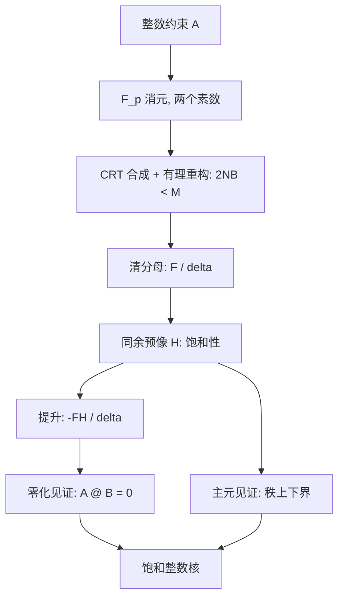

# cluster_space 重计算核心：Rust 化与溢出检查替代证书的理论调查

本页是静态代码与算术域分析，**未执行任何代码，也未做基准测量**。凡涉及相对代价、耗时与加速比的数字都标注为 [推断]。数学算法与完整性论证见[精确线性代数认证](../theory/advanced/exact-linear-algebra.md)，算术与分配契约见[数值契约](numerical-contracts.md)。

## 结论摘要

1. `cluster_space` 的"重计算"不是单一热点，而是三个共享同一算术纪律的精确整数阶段：稠密模消元（`foundation.integer.echelon`）、稀疏模 LU（`acoustic_factorization._factor`）、以及有理重构后的饱和核与三角因子恢复（`congruence_preimage`、`lift_congruence_kernel`、`_certify`），外加折叠秩的模素数上界论证（`mapping.folding._matrix_rank`）。矩阵规模由张量阶决定：行数约为 $|G|\cdot 3^p$，列数不超过 $3^p$。
2. Rust 替换在语义上可行，整数结果可逐位对应，但**主要收益不来自"用 Rust 写"，而来自模归约算法、残差位宽与批量化**。同一算法、同一数据下，Rust 与 Numba `nopython` 的差距在 $\pm 20\%$ 量级 [推断]。
3. Rust 的整数溢出检查**可以**替代"算术可表示性"这一义务，以及界内情形下 $C K=0$ 的模素数零化见证；但**不能**替代 CRT 重构唯一性 $2NB<M$、Hadamard 秩上界、整数核的饱和性构造。它们是数学命题，不是算术命题。
4. 因此正确的提法不是"用溢出检查替代证书"，而是"用检查算术替代证书中的**算术层**，保留**见证层**"。删除见证层会让 $C=(2,1,1)$ 一类反例重新成立：清分母基满足 $CK=0$，却不生成完整整数格。
5. Rust 的默认 `release` profile **静默环绕**。若在不开启 `overflow-checks`（或全程 `checked_*`/`strict_*`）的前提下把它当作证书使用，得到的是错误答案而不是失败。

## 1. 重计算核心的界定

### 1.1 三个入口

| 阶段 | 入口 | 数学产物 | 算术域 | 规模 | 代价 [推断] |
|---|---|---|---|---|---|
| 不变量基 | `basis.compute_invariant_basis` → `integer_kernel_basis` | 饱和整数核 $\ker_{\mathbb Z}C$ | int64，$\delta\le 2^{31}-1$，$\delta^2<2^{62}$ | $(\lvert G\rvert 3^p)\times d$，去重后 | $O(mnr)$ 模运算 $\times 2$ 素数，$O(rd^3)$ 同余预像 |
| 声学因子 | `acoustic.prepare_coordinates` → `factor_acoustic_equations` | 与 $A_{\rm ac}$ 同核的整数三角因子 | int64，`checked_add`/`checked_multiply` | CSR，行 $=\lvert\text{prefix}\rvert\cdot 3^p$，列 $=$ 该阶参数宽度 | 稀疏模 LU（哈希表）+ 有理重构 + 清分母恒等式 |
| 折叠秩 | `mapping.folding._matrix_rank` | $\operatorname{rank}_{\mathbb Q}T$ | Python 大整数算界，模素数算秩 | $(\lvert G\rvert 3^p)\times d$ | $O(mnr)$ 模运算 $\times$ 素数个数 |
| 辅助 | `basis.invariant_constraints`、`np.unique(axis=0)`、`foundation.tensors.apply_tensor_action` | 约束装配与去重 | 逐项上界 | 同上 | 遍历型，非算术密集型 |

其中 `integer_kernel_basis` 是唯一同时包含"稠密消元 + 有理重构 + 格论构造 + 零化验证"的完整流水线，也是移植评估的主体。

### 1.2 规模由张量阶而非体系尺寸决定

约束矩阵的列数是重复位点对称之后的独立张量分量数 $d\le 3^p$，行数是 $\lvert G\rvert\cdot 3^p$ 经 `np.unique` 去重后的结果；声学方程的列数是该阶的参数宽度，行数是 $\lvert\text{prefix}\rvert\cdot 3^p$。$p=4$ 时 $3^p=81$，$p=5$ 时 $243$。因此这里的"重计算"是**大量中小规模精确整数运算**，而不是大规模稠密线性代数；单次内核在毫秒量级 [推断]，端到端时间更可能由轨道枚举与 Python 编排决定。这一点直接限制了任何内核移植的收益上限（见 §3.3）。

### 1.3 现行算术纪律已经包含"检查算术"

`acoustic_factorization.checked_add` / `checked_multiply` 就是手写的溢出自检，`_certify` 全程使用它们并把失败转成 `OverflowError`，由 `factor_acoustic_equations` 的分母窗口循环 `continue` 重试。所以"用检查算术取代证书"在本仓库不是新机制，而是**已有机制的范围扩张**：问题只在于哪些义务可以扩张到它身上。

## 2. 现有证书的义务分解

| 义务 | 内容 | 实现位置 | 性质 | 溢出检查可否替代 |
|---|---|---|---|---|
| O1 | 每次加减乘取负的可表示性 | 各阶段局部准入、`checked_*`、模运算的 $q(q-1)<2^{62}$ 构造 | 算术 | **可以**，且更细 |
| O2 | 分配的形状/字节长度可表示性 | `arrays.require_allocation`、`require_bound` | 算术 + 平台 | **部分**，域不同 |
| O3a | 零化见证 $A B=0$ | `integer_kernel._verify_integer_kernel`（素数流） | 数学见证 + 算术 | **界内可以**（分层） |
| O3b | 清分母恒等式 $A=LU$ | `acoustic_factorization._certify` | 数学见证 + 算术 | **已经是**检查算术 |
| O3c | 秩见证（$U$ 主元对角、$L$ 末主元覆盖） | `_certify` 的 `found`/`seen` | 组合结构 | **不可以** |
| O4a | 有理重构唯一性 $2NB<M$ | `reconstruct_rationals` 的窗口 | 信息论 | **不可以** |
| O4b | 秩上界 $\prod p>\text{Hadamard}$ | `folding._matrix_rank` | 代数几何 | **不可以** |
| O4c | 整数核饱和性 | `congruence_preimage` 的逐行归纳 | 格论 | **不可以** |
| O4d | signed 分量完备性 | `integer_kernel.signed_components` | 图论 | **不可以** |

O1 与 O3a 的算术层可被替换；O3c 与全部 O4 是"这个候选是否证明了它声称的数学命题"，与任何语言的算术语义无关。

## 3. Rust 替换：语义与能力分析

### 3.1 三个真实的移植陷阱

**(a) `%` 与 `//` 的符号语义不同。** Python 与 Numba 对整数取模/整除采用 floor 语义，$-3 \bmod 5 = 2$。Rust 的 `%` 与 `/` 向零截断，$-3 \% 5 = -3$。精确核中多处依赖非负余数：`echelon` 的 `(a - factor * b) % prime`、`reduce_hnf_column` 的 `% delta`、`reconstruct_rationals` 的 `(second - first) % p2`；`reduce_hnf_column` 的 `q = h[i, column] // h[i, i]` 依赖 floor 除法。移植必须逐处改为 `rem_euclid` / `div_euclid`，否则在负系数上静默产生不同结果。

**(b) 排序与去重的平手顺序。** `np.unique(axis=0)` 按字典序，`np.argsort` 默认非稳定。这些顺序影响主元选择。Rust 端若用 `sort_unstable`，同一次运行内两次素数消元仍会得到相同顺序，因此**自洽性不受影响**；但基的列顺序可能与 Python 不同。基本来就非规范（`integer_kernel_basis` 文档明示），所以测试应按整数格比较，仓库已有的 `tests/oracles/exact_reference.py` 的 Smith 标准形参照正是为此准备的。

**(c) 浮点累加顺序。** `lift_lattice_coordinates` 与 `restrict_lattice_rows` 是精确认证之后的浮点三角求解；改变求和顺序会改变末位。移植需保持相同的迭代与累加顺序。

### 3.2 Rust 独有的能力增量（不只是更快）

1. **原生 `i128`。** 两个 `i64` 之积在 `i128` 中精确；`checked_add` 累加即可做直接点积。Numba 对 128 位整数支持有限。这是**能力**差异：直接零化检查的可用域显著宽于 `i64`。
2. **`u64` 残差的无检查精确性。** 取 $p<2^{31}$，则 $(p-1)^2+(p-1)=p(p-1)<2^{62}<2^{64}$。模乘与模加**按构造**不可能溢出，既不需要运行期检查，也不需要上界证明。这比"用溢出检查保证"更强也更便宜：构造性位宽优于运行期断言。
3. **Barrett/Montgomery 归约替代 `%`。** x86-64 的 64 位有符号 `idiv` 延迟约 20–40 cycles，`mulhi` 路径约 3–5 cycles，模消元阶段可有 3–5 倍算法级提速 [推断]。这是全部候选收益中最大的一项，且与语言无关：Numba 也能手写，但表达成本高、易被自动优化破坏。
4. **真正的 GIL 外并行。** `cluster_space` 与 `foundation.integer` 中的精确核均未启用 `nogil`，调用期间持 GIL（仓库其他模块有 `nogil=True`/`parallel=True` 的先例）；Rust 扩展可用 `allow_threads` 与线程池。但 `_factor` 的两个素数共用并依次写同一个 `schedule` 数组，存在跨素数数据依赖，**不可并行**；可并行的只有 `integer_kernel` 中两次独立的 `echelon`，以及按轨道、按阶的批量。因此并行收益有限。
5. **批量化接口。** 当前每个轨道、每个阶一次 Python→内核调用。Rust 扩展可以一次接收整组 CSR 矩阵，消除微秒级调度开销，并让 GIL 释放覆盖整个初始化阶段。

### 3.3 收益上限论证

设精确阶段占 `ClusterSpace(asr=True)` 初始化的比例为 $f$，该阶段提速 $s$ 倍，则端到端加速为 $1/(1-f+f/s)$。$f=0.1$、$s=4$ 时只有约 $1.3\times$。在 $f$ 未测量之前，任何"Rust 会显著加快初始化"的结论都不可靠。这也是把测量作为实施前置门槛的理由。

### 3.4 工程代价

- 构建：`pyproject.toml` 目前是纯 `hatchling`。引入 `maturin` 与 `abi3` 后仍需为 sdist 用户提供 Rust 工具链或纯 Python 回退。
- 双实现：精确核必须保留 Python 参考实现，否则差分测试失去基准。仓库的 `tests/oracles/exact_reference.py` 只能验证数学，不能验证移植一致性。
- CI：轮子矩阵（三平台 × `abi3`）、MSRV、`debug`/`release` 行为一致性。
- 依赖方向：若 Rust 核替换 `echelon`，`foundation.integer` 的公开契约（`RANK_PRIMES`、异常类型）必须保持不变，避免调用方改写。

## 4. 溢出检查替代证书：逐项判定

### 4.1 溢出检查究竟证明了什么

设表达式树中每一次加减乘取负都由检查算术执行并成功返回。对表达式树归纳可知：每个中间值等于其数学值，因此最后一个 `== 0` 是真命题。这是 O1 与 O3a 算术层的可靠基础。

它**不**证明：主元选择正确、索引与形状正确、商余数分解正确、重构唯一、整数格饱和、秩上界成立。它也**不**覆盖除零、`i64::MIN / -1`、越界索引——Rust 对这些分别 panic，而 panic 是失败，不是证明。换言之，检查算术把"值是对的"从假设变成结论，但对"这个问题问对了没有"无话可说。

### 4.2 O1/O2：可以，且更细

对 O1，检查算术严格优于"按最坏情形预先算界"的准入判据：后者按 $n\max\lvert A\rvert\max\lvert B\rvert$ 拒绝，检查算术按实际部分和判定。例如 $A=(1,1,1,1)$、$B=(J,-J,J,-J)$，静态界 $4J>J$ 会拒绝，但正负交替的累加顺序下每个部分和都在域内，检查算术会接受。反过来 $B=(J,J,-J,-J)$ 的第二个部分和溢出，检查算术拒绝。注意现行 `_verify_integer_kernel` 并不用该界拒收输入，只用它终止素数循环；这里比较的是两种**准入机制**的精细程度。

对 O2，检查算术**不能**完全替代 `require_allocation`：`usize` 上限是 $2^{64}-1$，`np.intp` 上限是 $2^{63}-1$，域不同；字节长度 $\text{itemsize}\cdot\prod s_i$ 仍需显式 `checked_mul`；`try_reserve` 只覆盖物理分配失败，不覆盖长度表示。

### 4.3 O3a：分层替换，证书退居后备

| 层 | 判定 | 代价 [推断] | 接受域 |
|---|---|---|---|
| Tier 0 | `checked_mul` + `checked_add` 直接算 $AB$，全零即证 | 单遍，$\approx$ 1 次模素数遍的一半 | 所用累加顺序下每个部分和可表示 |
| Tier 1 | 项内 `i128` 乘积、`i128` 检查累加 | 2–4 倍于 Tier 0 | 部分和 $\le 2^{127}-1$；实际系数下几乎全覆盖 |
| Tier 2 | 模素数流 + 大整数界（现状） | 每素数一遍模乘 | 任意 int64 输入 |

关键结论是**接受域的严格包含关系**：Tier 0/1 是 Tier 2 的真子集。模素数证书不需要任何关于系数幅值的界，这是它存在的根本理由；而检查算术必须在每个部分和处停下。因此证书机制**不能删除，只能降为冷路径**。

同时，Tier 0 有一个实质简化：现行 `_verify_integer_kernel` 用 Python 大整数算 $B_C=n\max\lvert A\rvert\max\lvert B\rvert$，Rust 需要 `u128` 或大整数库或对数空间保守界；而 Tier 0 根本不需要 $B_C$，由检查算术自行判定。这会把大整数依赖从热点路径中移除。

### 4.4 O4：不可替代（逐条）

**(a) $2NB<M$ 是信息论条件。** 当 $2NB\ge M$ 时，两个不同的既约分数可以在两个重构素数下有相同的余数对，重构结果是歧义的。检查算术只会把同一个歧义算得更精确，不会消除它。

**(b) Hadamard 秩上界是全局代数命题。** $\operatorname{rank}_{\mathbb Q}T\ge\max_p\operatorname{rank}_{\mathbb F_p}T$ 只是下界；上界需要"所有 $r+1$ 阶子式为零"，而该结论来自"素数乘积超过最大子式"。溢出检查对子式一无所知，也无法把"模同余为零"升级为"整数为零"——那正是 Tier 2 的素数乘积论证在做的事。

**(c) 饱和性不是零化。** 取 $C=(2,1,1)$。清分母基 $K=[(-1,2,0)^{\mathsf T},(-1,0,2)^{\mathsf T}]$ 满足 $CK=0$，Tier 0 与 Tier 1 都会通过，但 $(-1,1,1)^{\mathsf T}\in\ker_{\mathbb Z}C$ 不在 $K$ 的整数张成中。这个例子说明零化见证**不足以**证明整数格完整；`congruence_preimage` 的双射论证不可省。它也是"证书的见证层不能删"的最短证据。

**(d) signed 分量的完备性**是不动点归纳（带符号连通分量），与算术无关。

### 4.5 陷阱：release 默认静默环绕

Rust `release` profile 默认 `overflow-checks = false`，整数溢出静默环绕，程序继续并返回错误值。这比 Python 的无界整数和 Numba 的定宽环绕都更危险，因为失败不可见。要把它当证书使用，必须二选一：

- 在 `[profile.release]` 开启 `overflow-checks = true`（作用于本 crate，不作用于依赖），或
- 精确核全程使用 `checked_*` / `strict_*`，把 `None` 映射为统一定义的错误类型。

另外，稳定 Rust **没有**类型级区间分析：编译器不会在编译期证明"这里不会溢出"。唯一例外是常量求值（`const`/`static`），它对运行期数据无帮助。因此"编译期由类型系统证明无溢出"这一期待不成立。

### 4.6 向量化与分区使用

检查算术插入 `jo` 分支，阻止 LLVM 对点积循环做自动向量化。`echelon` 的内层 `(a - factor*b) % p` 是规则循环，理论上可向量化（除法仍是瓶颈）；若改为逐元素检查算术，可能反而变慢。合理的分区是：

- **见证验证**（一次通过、非热点、$O(\text{nnz})$）：用检查算术；
- **消元内层**（多遍、$O(mnr)$）：用固定位宽的构造性上界与环绕/掩码算术，不用运行期检查。

## 5. 若将来实施：分阶段方案与门槛

1. **先测量**（本页未做）。分别记录三个阶段在若干材料、阶数、截断下的耗时与峰值内存，分离冷 JIT 与热运行。门槛建议：目标阶段占初始化时间的比例 $f\ge 0.2$。
2. **只移植精确核**，保留 Python 参考实现与 Numba 回退，单一入口做特性检测。
3. **批量化接口 + `u32` 残差 + Barrett 归约 + `i128` Tier 1**。
4. **保留见证层**：Tier 0/1 作为快速路径，Tier 2 保留，接受域记录在案。
5. **验证**：整数格比较（Smith 参照）、极端系数、全量差分；移植前后逐层记录接受域，确保不静默缩小。

## 6. 对象映射与移植注意

| 数学对象 | 代码 | 移植注意 |
|---|---|---|
| 模行阶梯形 | `foundation.integer.echelon` | floor 语义、余数非负、主元行选择顺序 |
| 幂模 | `foundation.integer.modular_power` | 位宽构造上界，无需检查 |
| CRT 与有理重构 | `integer_kernel.reconstruct_rationals` | 扩展 Euclid 系数界、分母窗口语义 |
| 公分母 | `integer_kernel.scale_to_common_denominator` | 先除后乘的准入顺序必须保留 |
| 同余预像 | `integer_kernel.congruence_preimage` | 原地 HNF 约化；失败需事务性缓冲 |
| 提升 | `integer_kernel.lift_congruence_kernel` | 商余数流式分解，不得改为直接点积 |
| 零化见证 | `integer_kernel._verify_integer_kernel` | Tier 0/1 快速路径 + Tier 2 后备 |
| 稀疏模 LU | `acoustic_factorization._factor` | 哈希表可换为排序数组；`schedule` 跨素数依赖不可并行 |
| 清分母恒等式 | `acoustic_factorization._certify` | 已是检查算术；保留 `seen` 覆盖见证 |
| 折叠秩 | `mapping.folding._matrix_rank` | Hadamard 界需大整数或对数空间保守界 |

## 7. 未决问题

- `_factor` 的稀疏消元（Numba typed `Dict`）是否是实际热点，填充量与哈希开销均未测量。
- `np.unique(axis=0)` 是否应下沉到 Rust；它影响主元顺序，进而影响基的列顺序（但基非规范）。
- Hadamard 上界在 Rust 中的实现：大整数库、`u128` 饱和界或对数空间保守舍入；后者必须证明舍入方向，不能用浮点 `log` 直接比较。
- `abi3` + NumPy C-ABI 的兼容窗口，以及 sdist 用户无 Rust 工具链时的回退路径。
- 若引入 Tier 0/1，`ArithmeticRangeError` / `RankError` / `OverflowError` 的触发集合会改变；需要书面记录新的接受域，否则调用方的异常处理语义会漂移。
